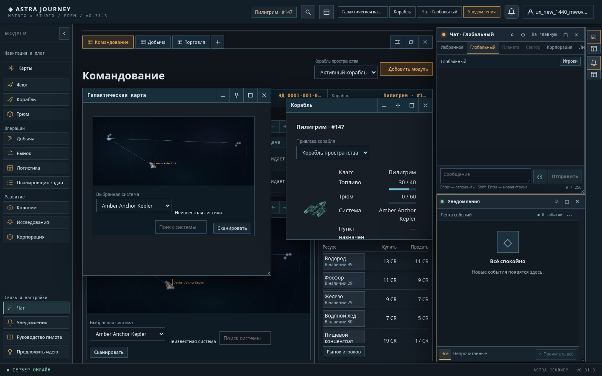

# MATRIX × STUDIO — сравнительные скриншоты

72 снимка в Chromium. Для каждого из шести сценариев показаны утверждённый прототип, опубликованный Web v0.31.5 и интерфейс из [PR №16](https://github.com/yomezza/astrajourney/pull/16).

Выберите нужный снимок в таблицах. Для просмотра локально скачайте каталог и откройте [HTML-галерею](index.html).

## 1920 × 1080

| Сценарий | Прототип | Web v0.31.5 | PR №16 |
| --- | --- | --- | --- |
| Командование | [PNG](1920x1080/01-command-prototype.png) | [PNG](1920x1080/01-command-production-v0.31.5.png) | [PNG](1920x1080/01-command-candidate.png) |
| Добыча | [PNG](1920x1080/02-mining-prototype.png) | [PNG](1920x1080/02-mining-production-v0.31.5.png) | [PNG](1920x1080/02-mining-candidate.png) |
| Торговля | [PNG](1920x1080/03-trade-prototype.png) | [PNG](1920x1080/03-trade-production-v0.31.5.png) | [PNG](1920x1080/03-trade-candidate.png) |
| Карта, корабль, чат и уведомления | [PNG](1920x1080/04-map-ship-comms-prototype.png) | [PNG](1920x1080/04-map-ship-comms-production-v0.31.5.png) | [PNG](1920x1080/04-map-ship-comms-candidate.png) |
| Редактирование пространства | [PNG](1920x1080/05-edit-prototype.png) | [PNG](1920x1080/05-edit-production-v0.31.5.png) | [PNG](1920x1080/05-edit-candidate.png) |
| Добавление и перемещение модулей | [PNG](1920x1080/06-add-and-reorder-prototype.png) | [PNG](1920x1080/06-add-and-reorder-production-v0.31.5.png) | [PNG](1920x1080/06-add-and-reorder-candidate.png) |

## 1440 × 900

| Сценарий | Прототип | Web v0.31.5 | PR №16 |
| --- | --- | --- | --- |
| Командование | [PNG](1440x900/01-command-prototype.png) | [PNG](1440x900/01-command-production-v0.31.5.png) | [PNG](1440x900/01-command-candidate.png) |
| Добыча | [PNG](1440x900/02-mining-prototype.png) | [PNG](1440x900/02-mining-production-v0.31.5.png) | [PNG](1440x900/02-mining-candidate.png) |
| Торговля | [PNG](1440x900/03-trade-prototype.png) | [PNG](1440x900/03-trade-production-v0.31.5.png) | [PNG](1440x900/03-trade-candidate.png) |
| Карта, корабль, чат и уведомления | [PNG](1440x900/04-map-ship-comms-prototype.png) | [PNG](1440x900/04-map-ship-comms-production-v0.31.5.png) | [PNG](1440x900/04-map-ship-comms-candidate.png) |
| Редактирование пространства | [PNG](1440x900/05-edit-prototype.png) | [PNG](1440x900/05-edit-production-v0.31.5.png) | [PNG](1440x900/05-edit-candidate.png) |
| Добавление и перемещение модулей | [PNG](1440x900/06-add-and-reorder-prototype.png) | [PNG](1440x900/06-add-and-reorder-production-v0.31.5.png) | [PNG](1440x900/06-add-and-reorder-candidate.png) |

## 1366 × 768

| Сценарий | Прототип | Web v0.31.5 | PR №16 |
| --- | --- | --- | --- |
| Командование | [PNG](1366x768/01-command-prototype.png) | [PNG](1366x768/01-command-production-v0.31.5.png) | [PNG](1366x768/01-command-candidate.png) |
| Добыча | [PNG](1366x768/02-mining-prototype.png) | [PNG](1366x768/02-mining-production-v0.31.5.png) | [PNG](1366x768/02-mining-candidate.png) |
| Торговля | [PNG](1366x768/03-trade-prototype.png) | [PNG](1366x768/03-trade-production-v0.31.5.png) | [PNG](1366x768/03-trade-candidate.png) |
| Карта, корабль, чат и уведомления | [PNG](1366x768/04-map-ship-comms-prototype.png) | [PNG](1366x768/04-map-ship-comms-production-v0.31.5.png) | [PNG](1366x768/04-map-ship-comms-candidate.png) |
| Редактирование пространства | [PNG](1366x768/05-edit-prototype.png) | [PNG](1366x768/05-edit-production-v0.31.5.png) | [PNG](1366x768/05-edit-candidate.png) |
| Добавление и перемещение модулей | [PNG](1366x768/06-add-and-reorder-prototype.png) | [PNG](1366x768/06-add-and-reorder-production-v0.31.5.png) | [PNG](1366x768/06-add-and-reorder-candidate.png) |

## 390 × 844

| Сценарий | Прототип | Web v0.31.5 | PR №16 |
| --- | --- | --- | --- |
| Командование | [PNG](390x844/01-command-prototype.png) | [PNG](390x844/01-command-production-v0.31.5.png) | [PNG](390x844/01-command-candidate.png) |
| Добыча | [PNG](390x844/02-mining-prototype.png) | [PNG](390x844/02-mining-production-v0.31.5.png) | [PNG](390x844/02-mining-candidate.png) |
| Торговля | [PNG](390x844/03-trade-prototype.png) | [PNG](390x844/03-trade-production-v0.31.5.png) | [PNG](390x844/03-trade-candidate.png) |
| Карта, корабль, чат и уведомления | [PNG](390x844/04-map-ship-comms-prototype.png) | [PNG](390x844/04-map-ship-comms-production-v0.31.5.png) | [PNG](390x844/04-map-ship-comms-candidate.png) |
| Редактирование пространства | [PNG](390x844/05-edit-prototype.png) | [PNG](390x844/05-edit-production-v0.31.5.png) | [PNG](390x844/05-edit-candidate.png) |
| Добавление и перемещение модулей | [PNG](390x844/06-add-and-reorder-prototype.png) | [PNG](390x844/06-add-and-reorder-production-v0.31.5.png) | [PNG](390x844/06-add-and-reorder-candidate.png) |
