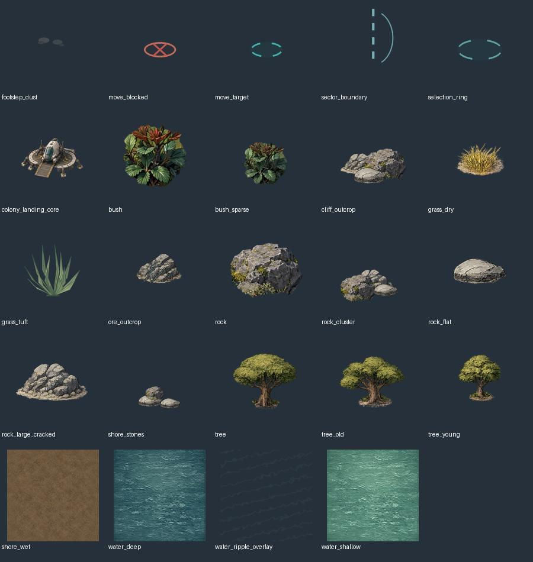
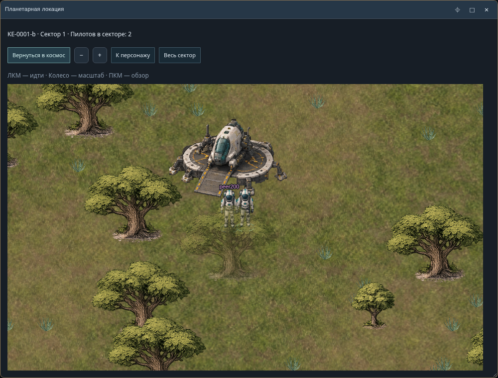
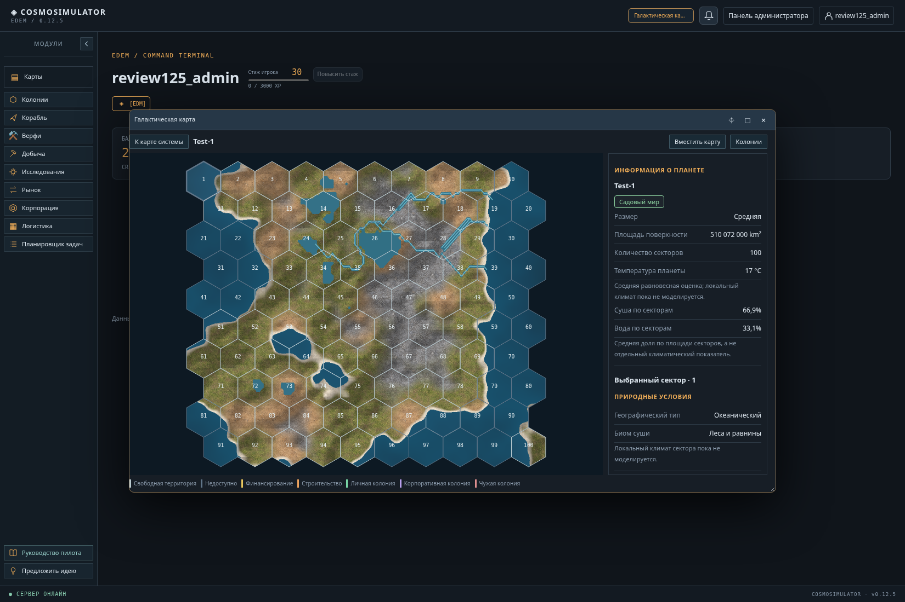
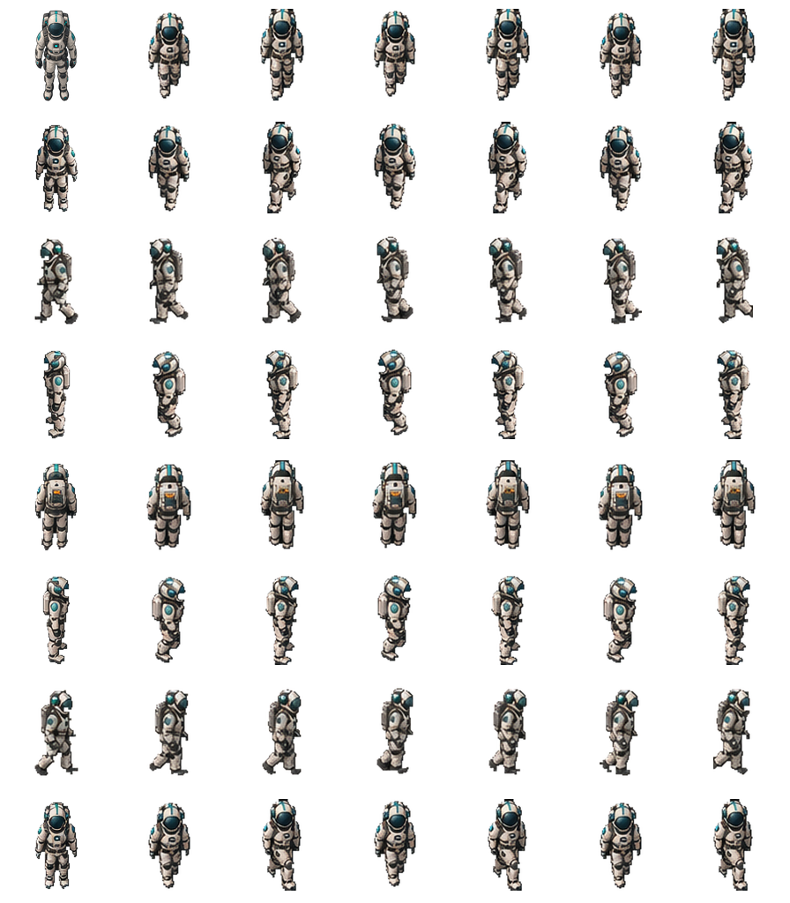

# Sources — визуальные эталоны и контекст для генерации Astra Journey

**Если вы другой ИИ или художник, начните здесь.** В этом каталоге находятся реальные изображения-ориентиры из репозитория и документы, объясняющие, *что сохранять*, *чего избегать* и *как экспортировать игровые ресурсы*. Это не папка для случайных красивых космических иллюстраций.

## Изображения: смотреть в таком порядке

### 1. Объекты планетарного режима — главный референс

[Открыть крупнее](ref-objects.jpg). Показывает уже согласованный тип графики: жилые и технические модули, скалы, деревья, растительность, колонист. Контактный лист — **только визуальный указатель**, не игровой спрайт.

### 2. Реальная игровая сцена — оценка масштаба

[Открыть крупнее](ref-sector.png). Важны относительный размер объектов, читаемость и взаимодействие графики с картой. Не копируйте интерфейс со скриншота внутрь новых PNG.

### 3. Текстуры грунта — отдельный верхний ракурс

[Открыть крупнее](ref-terrain.png). Грунт отличается от предметных спрайтов: строго вертикальная камера, повторяемый узор, никакого горизонта или встроенных зданий.

### 4. Колонист — существующий технический атлас

[Открыть крупнее](ref-colonist-atlas.png). **Важно: это технический прототип, не эталон идеальной анимации**. Диагональные направления и шаг в версии 0.2.0-preview требуют художественной доработки. Сохранять костюм и техническую сетку экспорта; не повторять недостатки движения.

## Текстовые источники

- [STYLE_GUIDE.ru.md](STYLE_GUIDE.ru.md) — канон стиля, камера, цвет, свет, прозрачность, масштаб, ограничения Canvas.
- [PROMPTS.ru.md](PROMPTS.ru.md) — готовые промпты для предметов, окружения, текстур, персонажа и исправления артефактов.
- [references.json](references.json) — машиночитаемый индекс файлов, их ролей и первоначального происхождения.
- [Исходный артпак v2](../planet-colony/artpacks/cosmosimulator_planet_2d_artpack_v2.zip) — **главный источник отдельных игровых PNG**, метаданных и путей. Для редактирования конкретного предмета извлеките его PNG из архива, а не обрезайте скриншот или контактный лист.

## Что считается исходником

В этом каталоге размещены *побайтные копии существующих обзорных файлов* из репозитория, а не заново сгенерированные картинки. Права и история происхождения определяются исходным репозиторием. Отдельные игровые PNG находятся в артпаке по ссылке выше.

**Не утверждайте, что послойные PSD/KRA/ASE доступны:** текущий исходный артпак содержит экспортированные PNG и скрипты/метаданные, а не полноценные редактируемые художественные слои.

Новые эталоны добавляйте сюда **только после сравнения с действующим набором**: указывайте имя, назначение, происхождение, дату/версию и статус (референс, прототип, утверждённый ресурс).
