# Голографический проектор новостей

## Общий вид



[Открыть SVG](news-hologram-preview.svg) · [Интерактивный предпросмотр](preview.html)

**Статус:** экспериментальный визуальный комплект (не включён в рабочий frontend). Пять независимых прозрачных анимированных SVG-слоёв и шестой объединённый векторный предпросмотр. Новости и перевод надписей выводит HTML, а не SVG. В состав проекта не входят реальные API, модуль новостей или изменения чата.

Художественная основа: пространственная каркасная конструкция **06-orbit** + мягкое свечение и бегущие импульсы **04-hologram**. Технологическое устройство внизу, две обращённые друг к другу новостные проекции по бокам, управляющий шестиугольник по центру. Палитра перекликается с `internal/server/web/styles/tokens.css`: `#10151b` / `#171e26` / `#78c7d9`, янтарь `#efad58` как акцент.

## Проекционное устройство



[Открыть SVG](news-projector-base.svg)

- **Ресурс:** `news-projector-base.svg`; **viewBox:** `0 0 900 560`; фон прозрачный.
- Нижнее физическое устройство с трёхточечной излучающей системой, металлическими гранями и пульсирующим ядром. Анимации CSS: мягкое дыхание ядра и бегущая линия кольца.
- Слой выше общей композиции, привязан к её нижнему краю. Металлические поверхности намеренно непрозрачны; фон остается прозрачным.

## Левая голографическая панель



[Открыть SVG](news-panel-left.svg)

- **Ресурс:** `news-panel-left.svg`; **viewBox:** `0 0 900 560`; прозрачный фон.
- Косая каркасная проекция, пространственное смещение задней рамки, мягкий свет, медленное парение (6,8 с), световые импульсы.
- Динамический текст размещается отдельным HTML-слоем примерно в пределах `x=99..320, y=216..349`. Вектор не содержит заголовков, дат или категорий.

## Правая голографическая панель



[Открыть SVG](news-panel-right.svg)

- **Ресурс:** `news-panel-right.svg`; **viewBox:** `0 0 900 560`; прозрачный фон.
- Встречный зеркальный ракурс с голубым свечением и янтарной пиктограммой, парение (7,5 с), бегущие световые импульсы.
- Динамический текст — HTML-слой примерно `x=594..812, y=216..349`, без обязательного масштабирования или 3D-вращения букв.

## Проекционные лучи



[Открыть SVG](news-projection-beams.svg)

- **Ресурс:** `news-projection-beams.svg`; **viewBox:** `0 0 900 560`; прозрачный фон.
- От трёх излучателей идут оптически лёгкие световые конусы, линии и бегущие вверх частицы. CSS-анимация (5,6 с), плавный запуск (1,7 с).
- Размещается **за** панелями и проектором.

## Центральная кнопка



[Открыть SVG](news-all-button.svg)

- **Ресурс:** `news-all-button.svg`; **viewBox:** `0 0 900 560`; прозрачный фон.
- Объёмный шестиугольный обод, два эллиптических кольца, яркий пробег по контуру. Внутри SVG **нет** текста «Все новости»: RU/EN задаёт настоящий HTML `button`.
- На hover/focus HTML-предпросмотр усиливает свечение слоя; на click — краткий визуальный отклик **без** открытия окна новостей.

## Общая композиция


[Открыть полноразмерную композицию](news-hologram-preview.svg)

- **Ресурс:** `news-hologram-preview.svg`; **viewBox:** `0 0 900 560`; прозрачный фон.
- Самостоятельный векторный превью-файл: точные геометрические слои исходных пяти SVG встроены в него при сборке (без внешних ссылок), а примеры новостей добавлены **только** в этот демонстрационный ресурс.
- GitHub Markdown может не проигрывать CSS-анимации; прямые ссылки выше позволяют открыть каждый SVG. Для полной работы с hover, динамическим текстом и языками откройте `preview.html` в браузере.

## Интерактивный просмотр

[Открыть исходный HTML](preview.html). GitHub показывает его как код, а не запускает как приложение. Скачайте **весь каталог** `docs/ideas/news`, чтобы относительные пути сохранились, и откройте `preview.html` локально. Альтернатива из корня репозитория:

```bash
python -m http.server 8000
# В браузере: http://localhost:8000/docs/ideas/news/preview.html
```

Есть смена языка RU/EN, интерактивный `button`, короткая анимация клика, раздельные SVG-слои, макет двух слотов и адаптация к ширине. API новостей, окна и настоящее подключение к домашней странице намеренно отсутствуют.

## Примеры использования во Frontend

Ниже пример **для будущей интеграции** в `#news-home-slot` рядом с `#chat-home-slot`. Он не является частью игры; реальную загрузку новостей, i18n и обработчик открытия окна подключает frontend-разработчик. Обратите внимание: существующий стиль демоверсии задаёт `#news-home-slot { pointer-events:none }`, а до 880px скрывает этот слот целиком. При интеграции нужно локально разрешить интерактивность новостного виджета, не меняя стили чата.

### HTML: размещение слоёв и текста

```html
<section id="news-home-slot" aria-label="Новости">
  <div class="news-hologram">
    
    
    
    
    

    <article class="news-item left" aria-label="Первая новость">
      <small data-field="category">Исследования</small>
      <h3 data-field="title">Обнаружена звёздная система</h3>
      <p data-field="summary">Пример описания новости.</p>
      <time data-field="time">15 минут назад</time>
    </article>
    <article class="news-item right" aria-label="Вторая новость">
      <small data-field="category">Экономика</small>
      <h3 data-field="title">Изменение поставок</h3>
      <p data-field="summary">Пример описания новости.</p>
      <time data-field="time">42 минуты назад</time>
    </article>

    <button type="button" class="news-all" aria-label="Все новости">
      <span data-i18n="all-news">Все новости</span>
    </button>
  </div>
</section>
```

### CSS: проекция, масштабирование и интерактивность

```css
#news-home-slot .news-hologram {
  position: relative;
  width: 100%;
  aspect-ratio: 900 / 560;
  container-type: inline-size;
  isolation: isolate;
  min-width: 0;
  pointer-events: auto; /* override demo slot pointer-events:none */
}
.news-layer { position:absolute; inset:0; width:100%; height:100%; pointer-events:none; }
.news-layer.beams { z-index:1; }
.news-layer.left-panel, .news-layer.right-panel { z-index:2; }
.news-layer.controller { z-index:3; transition:filter .2s; }
.news-layer.projector { z-index:5; }
.news-item { position:absolute; top:39%; width:24%; height:30%;
  z-index:4; display:flex; flex-direction:column; overflow:hidden;
  gap:.65cqw; color:#dce5ed; pointer-events:none;
  font-size:clamp(8px,1.4cqw,12px);
}
.news-item.left { left:11%; transform:rotate(-5deg); transform-origin:left top; }
.news-item.right { left:66%; transform:rotate(5deg); transform-origin:right top; }
.news-item h3 { margin:0; font-size:clamp(10px,1.85cqw,17px); line-height:1.2; }
.news-item p { margin:0; }
.news-item time { margin-top:auto; }
.news-all { position:absolute; left:43%; top:40%; width:14%; height:13%;
  z-index:6; color:#dbfff3; background:transparent; border:0;
  cursor:pointer; font-weight:bold; font-size:clamp(8px,1.5cqw,15px);
}
.news-hologram:has(.news-all:hover) .controller,
.news-hologram:has(.news-all:focus-visible) .controller {
  filter:brightness(1.6) drop-shadow(0 0 9px #61e5d8);
}
.news-all:focus-visible { outline:2px solid #78c7d9; }
.news-all:active { transform:scale(.96); }
@container (max-width:570px) { .news-item p { display:none; } }
@media (prefers-reduced-motion:reduce) {
  .news-layer.controller { transition:none; }
}
```

### JS: динамическое наполнение и i18n

```js
function showNews(root, news, labels) {
  const cards = root.querySelectorAll(".news-item");
  for (let i = 0; i < Math.min(2, news.length); i++) {
    const card = cards[i];
    for (const key of ["category", "title", "summary", "time"]) {
      card.querySelector(`[data-field="${key}"]`).textContent = news[i][key] ?? "";
    }
  }
  const button = root.querySelector(".news-all");
  button.querySelector("[data-i18n=all-news]").textContent = labels.allNews;
  button.setAttribute("aria-label", labels.allNews);
  // В реальном frontend подключить Modules.open(...) здесь.
}
```

Не вставляйте данные пользователей в HTML через `innerHTML`: используйте `textContent`. Для узкого экрана разработчик может перестроить новости вертикально или скрыть проектор в соответствии с текущей сеткой; при ширине до 880px оригинальный `#news-home-slot` сейчас скрывается.

## Генерация и проверка

`sources/generate_news_holograms.py` формирует **только общий SVG-превью** из пяти самостоятельных SVG-источников и демонстрационных строк. Отдельные SVG созданы векторными средствами и являются первичными редактируемыми ресурсами; скрипт не заменяет их.

```bash
python3 docs/ideas/news/sources/generate_news_holograms.py
```

Каждый SVG независим, без `foreignObject`, `script`, внешних шрифтов, растра и ссылок на чужие изображения. Анимации CSS отключаются через `prefers-reduced-motion`. Существующий `UI.hologram` управляет корабельными голограммами; демонстрационный проектор не нужно передавать в этот загрузчик как корабль — его композиция рассчитана на отдельные позиционированные HTML-слои.


---

## Варианты голографического отображения текста

Три экспериментальных способа отображать новости, **не меняя утверждённый SVG-проектор**, опубликованы в [text-variants/](text-variants/comparison.html). Поддержаны RU/EN, короткие/обычные/длинные заголовки, длинные описания, отсутствие описания и отсутствие одной новости. Тексты остаются HTML и заполняются через \`textContent\`; сами производственные SVG не содержат новостей.

### [Открыть сравнение A / B / C](text-variants/comparison.html)

Демонстрационный HTML на GitHub отображается как исходный код. Чтобы увидеть анимацию и переключатели, из корня репозитория запустите \`python -m http.server 8000\` и откройте:

\`http://localhost:8000/docs/ideas/news/text-variants/comparison.html\`

Выберите ширину **420 или 520 px**: она приближена к реальному правому слоту двухколоночной демоверсии. При 900 px текст демонстрационно крупнее, но не отражает обычную компоновку главной страницы.

### A — Голографическая типографика



[Самостоятельный HTML-вариант A](text-variants/variant-a/index.html) · [Прямое SVG-превью A](text-variants/variant-a/preview.svg)

Буквы воспринимаются как источники мягкого света, кромки подчеркнуты тонкими сканирующими разделителями. Никакой непрозрачной карточки. При ширине правого слота выглядит очень воздушно, но текст сильнее зависит от контрастности фона и длины заголовка.

### B — Информационный голографический терминал



[Самостоятельный HTML-вариант B](text-variants/variant-b/index.html) · [Прямое SVG-превью B](text-variants/variant-b/preview.svg)

Тонкий полупрозрачный слой считывания, световая шкала и компактная информационная иерархия внутри объёмного обода. Подложка не превращает панель в обычную UI-карточку: она почти прозрачна, её оправдывает геометрия устройства. Наиболее устойчивое чтение при 420–520 px.

### C — Объёмная голографическая сводка



[Самостоятельный HTML-вариант C](text-variants/variant-c/index.html) · [Прямое SVG-превью C](text-variants/variant-c/preview.svg)

Миниатюрная тематическая векторная голограмма (звезда, планета или график) входит в композицию новости. Такой подход эффектен в крупном размере и позволяет моментально распознать категорию, однако маленький объект частично отнимает ширину у длинного заголовка.

**Все три картинки — только статические примеры композиции со встроенными демонстрационными словами.** Рабочие тексты в соответствующих HTML-демонстрациях остаются полностью динамическими.

### Сравнение читаемости

| Критерий | A | B | C |
|---|---|---|---|
| Связь текста с голограммой | высокая — световая типографика | высокая — телеметрическая плоскость | очень высокая — мини-объект |
| Контраст заголовка на 420–520 px | умеренный | **лучший из трёх** | умеренный |
| Длинные заголовки | удовлетворительно; обрезка | **наиболее устойчиво** | ограниченное место из-за символа |
| Новость без описания | корректно | корректно | корректно |
| Отсутствие новости | неактивная проекция | неактивное сообщение | ослабленный символ |
| Художественная сложность | минималистичная | сбалансированная | самая выразительная |
| Предполагаемое применение | атмосфера | **новостная лента по умолчанию** | важные события |

Оценка основана на доступной площади в проекте и выбранных CSS-ограничениях, а не на результатах пользовательских исследований. При уменьшении ширины приоритет отдаётся заголовку; описание скрывается, а заголовок ограничивается максимум тремя строками с многоточием. Полный текст доступен через атрибут \`title\` и \`aria-label\`, а в будущем должен открываться в настоящем модуле новостей.

### Перспектива, синхронизация и динамика

- HTML-текст наклонён примерно на ±4,2°, а основную перспективу создают каркасные SVG-контуры, поэтому сами буквы почти не искажаются.
- Отдельные контейнеры текста анимируются с теми же периодами, что и панели (**6,8 с** и **7,5 с**), и с амплитудой \`0.555cqw\` — это примерно 5 исходных SVG-пикселей при ширине 900 px. Поведение синхронизировано *по периодам*, хотя отдельные анимационные часы SVG, загруженных через \`img\`, могут немного различаться по фазе.
- Интенсивное мерцание букв не используется. Поддерживается \`prefers-reduced-motion\`.
- Категория и время вторичны по отношению к заголовку; описание на узкой ширине скрывается до того, как шрифт становится слишком мелким.
- Кнопка остаётся настоящим доступным HTML \`button\`, с двумя строками «Все / новости» и «All / news», hover/focus/click и без подключения игрового окна.
- Иллюстративные знаки категорий в HTML — компактная векторная геометрия, не фиксированный контент основного SVG.

### Размеры в настоящей компоновке

Текущее \`#home-lower-grid\` состоит из двух равных колонок с промежутком 14 px. При этом \`#news-home-slot\` имеет \`pointer-events:none\` и целиком скрыт при ширине окна до **880 px**. Экспериментальные страницы специально показывают проектор при 420/520/680/900 px, но не меняют эти существующие правила. При интеграции frontend-разработчику понадобятся изолированное разрешение \`pointer-events:auto\` для кнопки и отдельное решение для мобильной компоновки.

### Рекомендация

**Рекомендую B** как основной вариант: он даёт наиболее чёткую иерархию заголовка на ограниченной ширине и при этом ощущается частью проекции. Из A можно позднее перенять тонкие световые разделители, из C — маленькую тематическую голограмму для особо важных новостей. Ничего из этого пока не утверждено и не перенесено в production.

**Состав эксперимента:** [comparison.html](text-variants/comparison.html), три самостоятельных \`index.html\`, три статических \`preview.svg\`, общие \`shared/style.css\` и \`shared/demo.js\`. Эти файлы размещены отдельно и не заменяют прежний \`preview.html\` или исходные SVG проектора.
