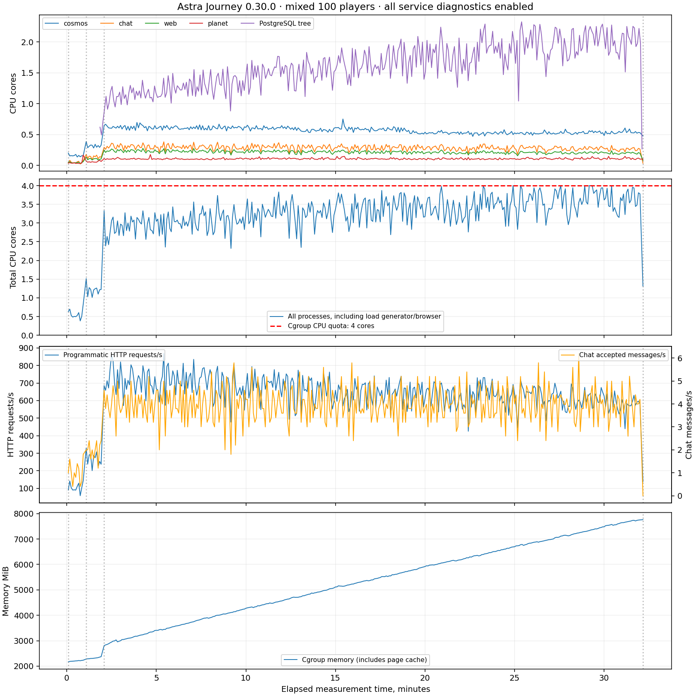

# Нагрузочный эксперимент: 100 игроков, Astra Journey 0.30.0

**Выполнено 17 ноября 2026 года.** Пять процессов выдержали полчаса при 100
подключённых игроках, но интерфейс чата обслуживался с большим числом отказов.
Утверждение «100 активных игроков работают без проблем» результатом не подтверждено.
Это baseline до оптимизации, без публикации или изменения игровых служб.

## Условия

- Опубликованные Linux amd64 бинарники 0.30.0. SHA-256 всех пяти файлов совпал
  с [build manifest](../../downloads/astra-journey-v0.30.0-build.json);
  исходный build commit `8bcbad894d5516addb1544586226257fae12fa97`.
- Один общий контейнер: лимит **4 CPU и 32 GiB RAM**. PostgreSQL, NATS,
  генератор нагрузки и Chromium находились на этой же машине, сеть loopback.
- PostgreSQL 17.12, NATS 2.12.3 с TLS и отдельными ACL пяти служб. Chat `b1`.
  Пулы Cosmic, Planet, Chat — до восьми соединений каждый; с тестовыми
  соединениями наблюдалось около 28 подключений БД.
- `diagnostics.enabled=true` у всех служб; сохранены структурированные,
  консольные, старый Planet-журнал и журнал NATS. Автосинхронизация пакетов
  выключена, установлены опубликованные ZIP локально.
- Новая временная база, 3000 систем, одна сгенерированная планета, шесть
  корпоративных секторов. Стартовые корабли, знания, ресурсы и права подготовлены
  до измерения. Команды выполнялись через настоящие HTTP/WS службы и Web-шлюз.

Подготовительный прогон: 5 → 10 → 20 игроков, 74,4 секунды с настройкой стенда.
Основной: 25 и 50 игроков по минуте, затем **100 игроков 1800 секунд** и 10 секунд
drain. Полный тест занял 1949,3 секунды. Интервал 100 игроков — примерно
**17 ноября, 17:45–18:15 по Екатеринбургу**; run ID и машинные даты в UTC.

## Что делали игроки

30 участников ходили по поверхности, строили/удаляли объекты и переходили
между секторами. Остальные торговали, работали со складом, добывали ресурсы,
летали, исследовали системы или выполняли перевозку через планировщик.
Терминал обновлял семь игровых API примерно раз в пять секунд.

80 игроков отправляли сообщения с индивидуальным интервалом 15–25 секунд:
примерно четыре сообщения в секунду, не 80 сообщений в секунду. Все 100 читали
чат. Использовались глобальный, корпоративный, планетарный и секторный каналы.
После `sync` клиенты запрашивали bootstrap, notifications, history с debounce.

99 участников — протокольные HTTP/WS-клиенты, **один из 100 — настоящий Chromium**
с опубликованным интерфейсом. Это нагрузка на реальные службы, но не 100
одновременных браузерных рендереров или полностью воспроизведённое поведение людей.

## Результат основного этапа

| Показатель | Результат |
| --- | ---: |
| HTTP-запросы протокольных участников через Web | 1 176 578 |
| Средняя частота | 653,7 запроса/с |
| HTTP 200 | 904 857 |
| HTTP 429, все из Chat `server_busy` | **269 157** |
| HTTP 409, исчерпана игровая квота добычи | 2 564 |
| HTTP 5xx / транспортные сбои драйвера | **0 / 0** |
| Незапланированные разрывы Chat / Planet | **0 / 0** |
| Соединения в конце нагрузки | 100 Chat, 30 Planet |
| Подтверждённые перемещения по поверхности | 9 235 |
| Завершённые переходы между секторами | 446 |

На этапах 25 и 50 игроков все 6292 и 16 530 HTTP-запросов соответственно получили
200. При 100 участниках **22,9% всех запросов**, или **31,6% трёх HTTP-запросов
обновления чата**, получили 429. Это ухудшение обслуживания, хотя процессы не
упали и HTTP 5xx не было. Драйвер завершился `PASS`: это означает завершение
сценария, а не прохождение критерия «нет пользовательских отказов».

У Chat в [limits.go](../../internal/chatserver/limits.go) общий предел 64
одновременных HTTP-запроса. Сигналы после сообщений вызывают массовые обновления
клиентов. При восьми соединениях БД и дорогом bootstrap образуется очередь,
часть запросов сразу получает `server_busy`. Это не ограничение по IP и не
ошибка прав NATS.

## Задержки

| Операция при 100 игроках | p95 | p99 |
| --- | ---: | ---: |
| Обновление семи API терминала целиком | 188,8 мс | 358,1 мс |
| GET workbench | 188,2 мс | 356,5 мс |
| Подтверждение команды движения Planet | 123,8 мс | 206,2 мс |
| Подтверждение отправки сообщения Chat | 197,2 мс | 277,9 мс |
| От отправки до первого обнаружения в истории | 604,9 мс | 1022,1 мс |

Последняя строка измеряет первого наблюдающего клиента, в том числе отправителя,
**не всех получателей**. HTTP-перцентили по endpoint включают все его коды ответа;
особенно для Chat их нужно читать вместе с долей 429.

В последнем снимке Cosmic: p95 лага фонового цикла 220,6 мс, максимум за процесс
599 мс; ошибок мировых тиков — 0. За основной этап мир продвинулся на 170 тиков.
Planet: p95 лага движения 12,2 мс в последнем окне 2048 измерений, ошибок
checkpoint — 0, ошибок записи в транспорт — 0, отклонений очереди pathfinding — 0.

## Ресурсы и лишняя работа

| Процесс / группа | Среднее занятых ядер при 100 игроках |
| --- | ---: |
| PostgreSQL вместе с дочерними процессами | 1,624 |
| Cosmic | 0,569 |
| Chat | 0,285 |
| Web | 0,216 |
| Planet | 0,107 |
| CDN / NATS | 0,0003 / 0,0015 |
| Генератор HTTP/WS / Chromium с дочерними процессами | 0,187 / 0,291 |
| Весь cgroup, включая наблюдение | **3,321 из 4** |

`1,0` — одно полностью занятое ядро. p95 общего CPU — 3,917 ядра: на всплесках
контейнер почти выбирал квоту. Средний расход игровых служб, PostgreSQL и NATS
составил около 2,80 ядра; из общего CPU нельзя делать вывод о чистом расходе
серверной части без генератора и браузера.

Отдельный тревожный тренд: средний CPU PostgreSQL вырос с **1,17 ядра в первые
пять минут** этапа 100 игроков до **2,01 ядра в последние пять минут**, хотя
HTTP-частота к концу снизилась. Это требует разбора растущей работы в БД;
конкретный SQL как единственная причина здесь не установлен. Кандидаты для
профилирования — повторное чтение outbox и запросы чата при росте истории.

К концу измерения RSS отдельных пяти Go-служб — примерно 14–66 MiB. Максимальный
наблюдённый `memory.current` контейнера — 7,57 GiB, включая кеш файлов журналов.
Журналы заняли **4,46 GiB**: часть записей продублирована в console/jsonl и
старом Planet-журнале. Сам по себе рост cgroup memory не доказывает утечку.
Сумма RSS PostgreSQL многократно учитывает общие страницы и отдельно не выдаётся
за физически занятую память.

В последнем снимке счётчиков: около 5,76 млн клиентских SQL-вызовов у Chat,
4,88 млн у Cosmic и 1,61 млн у Planet с запуска процессов. Это вызовы pgx,
не число внутренних операторов хранимых функций. B1 прочитал около 1,53 млн
строк outbox, из них 1,52 млн распознал как повторные при overlap. Нельзя просто
убрать overlap: он защищает доставку поздно зафиксированных транзакций.

Повторные history-ответы Chat передали **4,73 GB тел** только протокольным
клиентам основного этапа. Это подтверждает приоритет сокращения массовой
перезагрузки истории и метаданных. Наличие конкретного недостающего индекса
этот эксперимент не установил; планы запросов здесь не снимались.

## Данные, NATS, графика и браузер

За весь прогон отправлено и успешно подтверждено **7363 сообщения**. В БД найдено
ровно 7363 сообщения с меткой прогона и столько же уникальных ID; каждое хотя бы
раз обнаружено клиентом в истории. Это не доказательство доставки каждому
получателю без промежуточных пропусков обновления.

Финальная сверка: 100 пользователей и 100 кораблей; отрицательных пользовательских
балансов и элементов корабельного груза — 0; все 19 созданных задач планировщика
завершены. В наблюдении незадолго до конца: 1667 завершённых добыч, 600 команд
межсистемного перелёта, 185 завершённых исследований, более тысячи покупок и
продаж. Источник этих событий имеет отдельную временную метку, не является
единой транзакцией финальной сверки.

У NATS сохранялись пять подключений служб, `slow_consumers=0`. Chat не отметил
потерь hint, ошибок TLS/ACL или reconnect. В финальном снимке нет ошибок
диспетчерского сканирования. Брокерная доставка здесь не была главным расходом.

Дополнительный короткий всплеск медиа через Web → CDN: 100 виртуальных клиентов,
680 выбранных SVG/PNG-загрузок, **48 242 640 байт**, все SHA-256 совпали и ответы
имели `immutable`. Все 11 ETag-проверок вернули 304. Запросы этой отдельной пробы
не входят в 1 176 578 запросов игрового драйвера. Это не измерение холодной
загрузки всех ассетов в 100 настоящих браузерах.

Настоящий браузер: первая готовность 1,08 с, 36 успешных открытий рынка,
планировщика и исследований; p95 открытия 283 мс, максимум 390 мс. JS-исключений
не зарегистрировано. Было 12 таймаутов клика по карте из-за закрытого `details`
в самом тесте; профиль/уведомления пропускались из-за выбора только sidebar.
Эти случаи не являются измерением производительности игры. Браузерный JSON —
последний периодический снимок; финальный screenshot исходная проба не сохранила.

В журналах также найдены один отменённый браузером запрос Cosmic и два внутренних
истечения дедлайна Planet при получении общего world-lock, с последующим
неуспешным rollback. Они дали SQL-счётчики 1 и 4 соответственно; checkpoint и
клиентские соединения сохранились. Поэтому «SQL-ошибок совсем не было» — неверно.

## Ограничения и следующий приоритет

Это одна приближённая модель на новой базе, с одной планетой и общей корпорацией.
Часть добытчиков исчерпала квоту и получала штатные 409; путешественники постепенно
расходовали стартовое топливо. Планировщики выполняли по одной перевозке.
Успешная космическая активность поэтому не оставалась одинаковой все полчаса;
терминал, чат и поверхность продолжали работать. Для следующего сравнения нужно
сохранить этот baseline и отдельно улучшить модель долгой игры: больше систем
добычи, пополнение топлива, новые задания вместо бесконечного ожидания.

Протокольный refresh не полностью воспроизводит frontend: он сериализует свои
обновления и продолжает notifications/history после неуспешного bootstrap.
Нет нагрузки приватных групп, поиска/модерации, read receipts, сотни GPU-рендереров,
большой старой истории сообщений или проверки аварийного восстановления NATS.
Между `a1` и `b1` сравнение не проводилось. Максимальная ёмкость не определена.

Первый практический приоритет — **Chat + его frontend**: уменьшить число полных
обновлений на один сигнал, управлять одновременными refresh и корректно переживать
429. Простое повышение лимита 64 может перенести очередь в БД. Затем сокращать
семь постоянных опросов терминала и проверять конкуренцию общих world-lock.
Индексы выбирать по планам оставшихся дорогих запросов, а не по одному факту CPU.

## Проверки и материалы

- Основной `TestMixedPlayers100`: PASS за 1949,3 с; поведенческий результат —
  **завершено с деградацией Chat**, не «capacity PASS».
- Повторная компиляция opt-in теста без флага запуска, Node syntax, Python AST,
  `git diff --check`: выполнены. Широкие регрессионные тесты продукта не запускались:
  исполняемый игровой код не менялся.
- Дочерние игровые процессы и NATS остановлены, созданная БД удалена; исходная
  тестовая база осталась. Два Chromium zombie ожидают reaping от PID 1 окружения;
  активных процессов браузера этого прогона нет. Чужие процессы не трогались.
- В новом драйвере исправлены сбор дерева процессов при отсутствии
  `/proc/task/children`, навигационные селекторы и обработка сигналов браузера.
  Основной baseline использовал первоначальную пробу; новый вариант не выдаётся
  за повторный полчасовой прогон.

[Как воспроизвести](../../tests/load/README.ru.md) ·
[Машинный отчёт](mixed100-0.30.0/report.json) ·
[Сводка](mixed100-0.30.0/summary.json) ·
[Тренд PostgreSQL](mixed100-0.30.0/trend.json) ·
[Последний снимок служб](mixed100-0.30.0/last-sample.json) ·
[График SVG](mixed100-0.30.0/overview.svg)

Полные исходные наблюдения и журналы находятся локально в
`dist/mixed100/20261117T124245.096651128Z/`. Архив `logs.tar.gz` — около 351 MiB,
не добавляется в Git. В репозитории сохранены компактные результаты и графики;
конфигурация с секретами, ключи TLS и service token туда не копировались.
